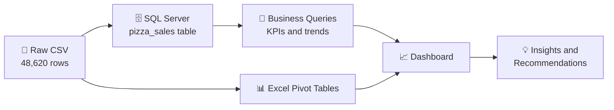
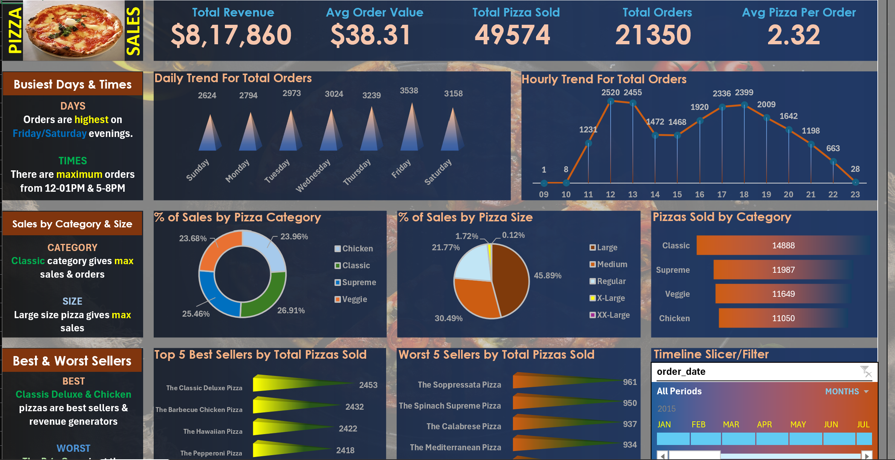

<div align="center">


<a href="https://github.com/RajayJain/quick-service-restaurant-analytics">
  
</a>

<br/>


[](https://github.com/RajayJain/quick-service-restaurant-analytics/wiki)

</div>

---

## 📌 Project Overview

This project analyses **one full year (2015) of transaction data** from a quick service pizza restaurant to answer the questions an operations or business manager would ask:

> *How much are we earning? When are we busiest? Which products and sizes drive revenue? What should we stop selling?*

Using **SQL Server** for querying and **Excel (pivot tables and charts)** for dashboarding, the analysis turns **48,620 raw order lines** into KPIs, trend analysis, product performance rankings and data-backed recommendations.

The project demonstrates:

- ✅ Writing business-driven **T-SQL** (aggregations, window-free percent-of-total logic, date functions, subqueries, `TOP N`)
- ✅ Defining and calculating **core retail KPIs** (Revenue, AOV, Orders, Basket Size)
- ✅ Time-series analysis by **day of week, hour of day and quarter**
- ✅ **Product and category mix** analysis
- ✅ Building an **interactive Excel dashboard** with pivot tables
- ✅ Translating numbers into **actionable recommendations**

---

## 🔄 Project Workflow



---

## 🛠️ Tech Stack

| Layer | Tool | Purpose |
|:--|:--|:--|
| 🗄️ Database | **Microsoft SQL Server (T-SQL)** | Data storage and business querying |
| 📊 Visualisation | **Microsoft Excel** | Pivot tables, charts and the dashboard |
| 📝 Documentation | **Word (.docx), Markdown** | Query documentation and README |
| 🔀 Version Control | **Git and GitHub** | Repository and wiki hosting |

---

## 🗂️ Dataset

| Attribute | Detail |
|:--|:--|
| 📅 Period | 01 Jan 2015 – 31 Dec 2015 |
| 🧾 Records | **48,620** order lines |
| 🛒 Unique orders | **21,350** |
| 🍕 Unique pizzas | **32** pizza types (91 size variants) |
| 🏷️ Categories | Classic, Supreme, Veggie, Chicken |
| 📏 Sizes | S, M, L, XL, XXL |
| ❓ Missing values | **0** |

### 🧱 Database Schema

**Table: `pizza_sales`**

| # | Column | Suggested SQL Server type | Description |
|:-:|:--|:--|:--|
| 1 | `pizza_id` | `INT` (PK) | Unique ID for each order line |
| 2 | `order_id` | `INT` | Order identifier (one order has many lines) |
| 3 | `pizza_name_id` | `VARCHAR(50)` | Pizza and size key, e.g. `hawaiian_m` |
| 4 | `quantity` | `INT` | Number of pizzas on the line |
| 5 | `order_date` | `DATE` | Date of the order |
| 6 | `order_time` | `TIME` | Time of the order |
| 7 | `unit_price` | `DECIMAL(5,2)` | Price of one pizza |
| 8 | `total_price` | `DECIMAL(7,2)` | `unit_price × quantity` |
| 9 | `pizza_size` | `VARCHAR(5)` | S, M, L, XL, XXL |
| 10 | `pizza_category` | `VARCHAR(20)` | Classic, Supreme, Veggie, Chicken |
| 11 | `pizza_ingredients` | `VARCHAR(255)` | Comma-separated ingredient list |
| 12 | `pizza_name` | `VARCHAR(100)` | Display name, e.g. *The Hawaiian Pizza* |

> 💡 The Excel workbook adds two helper columns (`Total_orders`, `order_day`) to support distinct-order counting in pivot tables. In the dashboard, size **S** is labelled **Regular**. Dates in the CSV are `dd-mm-yyyy`, so set `SET DATEFORMAT dmy` (or convert) when importing into SQL Server.

---

## 🎯 Key Numbers at a Glance

<div align="center">

| 💰 Total Revenue | 🧾 Total Orders | 🍕 Pizzas Sold | 🛍️ Avg Order Value | 📦 Pizzas / Order |
|:-:|:-:|:-:|:-:|:-:|
| **$817,860** | **21,350** | **49,574** | **$38.31** | **2.32** |

</div>

---

## 📈 Dashboard Preview

> Screenshot of the Excel dashboard (`data/Pizza_Sales.xlsx`).

<div align="center">



</div>

---

## 📊 Dashboard Highlights

The Excel dashboard (`data/Pizza_Sales.xlsx`) is built from pivot tables on the raw data and answers the main business questions at a glance.

| Dashboard area | What it shows | Headline number |
|:--|:--|:--|
| 🎯 **KPI cards** | Revenue, orders, pizzas sold, AOV and basket size | **$817,860** · **21,350** · **49,574** · **$38.31** · **2.32** |
| 📅 **Daily trend** | Orders by day of week | Friday peaks at **3,538**; Sunday dips to **2,624** |
| ⏰ **Hourly trend** | Orders by hour of day | Lunch peak **2,520** (12 PM); dinner peak **2,399** (6 PM) |
| 🏷️ **Sales by category** | Revenue share per category | Classic **26.9%** · Supreme **25.5%** · Chicken **24.0%** · Veggie **23.7%** |
| 📏 **Sales by size** | Revenue share per size | Large **45.9%** · Medium **30.5%** · Regular **21.8%** · XL **1.7%** · XXL **0.1%** |
| 🍕 **Pizzas sold by category** | Volume per category | Classic **14,888** · Supreme **11,987** · Veggie **11,649** · Chicken **11,050** |
| 🏆 **Best sellers** | Top 5 pizzas by volume | Classic Deluxe leads with **2,453** |
| 🔻 **Weakest sellers** | Bottom 5 pizzas by volume | Brie Carre trails with **490** |

---

## ❓ Business Questions and Solutions

> All queries live in [`sql/Business_Queries.sql`](sql/Business_Queries.sql), and the full set of query outputs is documented in [`docs/PIZZA_SALES_SQL_QUERIES.docx`](docs/PIZZA_SALES_SQL_QUERIES.docx). Click each question below to expand the SQL and its result.

### 💰 Section A: Core KPIs

<details>
<summary><b>Q1. What is the Total Revenue?</b> → <code>$817,860.05</code></summary>

```sql
SELECT CAST(SUM(total_price) AS DECIMAL(10,2)) AS Total_Revenue
FROM pizza_sales;
```
**Result:** `817,860.05`
</details>

<details>
<summary><b>Q2. What is the Average Order Value?</b> → <code>$38.31</code></summary>

```sql
SELECT SUM(total_price) / COUNT(DISTINCT order_id) AS Avg_Order_Value
FROM pizza_sales;
```
**Logic:** revenue divided by *distinct* orders, because one order spans several rows.
**Result:** `38.31`
</details>

<details>
<summary><b>Q3. How many pizzas were sold in total?</b> → <code>49,574</code></summary>

```sql
SELECT SUM(quantity) AS Total_Pizza_Sold
FROM pizza_sales;
```
**Result:** `49,574` pizzas, at an average of about **$16.50** per pizza.
</details>

<details>
<summary><b>Q4. How many orders were placed?</b> → <code>21,350</code></summary>

```sql
SELECT COUNT(DISTINCT order_id) AS Total_Orders
FROM pizza_sales;
```
**Result:** `21,350` orders, about **59.6 orders per trading day**.
</details>

<details>
<summary><b>Q5. What is the Average Pizzas per Order (basket size)?</b> → <code>2.32</code></summary>

```sql
SELECT CAST(CAST(SUM(quantity) AS DECIMAL(10,2)) /
       CAST(COUNT(DISTINCT order_id) AS DECIMAL(10,2)) AS DECIMAL(10,2))
       AS Avg_Pizzas_per_Order
FROM pizza_sales;
```
**Result:** `2.32`
</details>

---

### ⏰ Section B: Time-Based Trends

<details>
<summary><b>Q6. Which days of the week are busiest?</b> → <code>Friday (3,538 orders)</code></summary>

```sql
SELECT DATENAME(DW, order_date) AS order_day,
       COUNT(DISTINCT order_id) AS total_orders
FROM pizza_sales
GROUP BY DATENAME(DW, order_date);
```

| Day | Orders | Share |
|:--|--:|--:|
| Monday | 2,794 | 13.1% |
| Tuesday | 2,973 | 13.9% |
| Wednesday | 3,024 | 14.2% |
| Thursday | 3,239 | 15.2% |
| **Friday** | **3,538** | **16.6%** |
| Saturday | 3,158 | 14.8% |
| Sunday | 2,624 | 12.3% |

**Insight:** Friday beats Sunday by **35%**.
</details>

<details>
<summary><b>Q7. Which hours of the day are busiest?</b> → <code>12 PM (2,520 orders)</code></summary>

```sql
SELECT DATEPART(HOUR, order_time) AS order_hour,
       COUNT(DISTINCT order_id)   AS total_orders
FROM pizza_sales
GROUP BY DATEPART(HOUR, order_time)
ORDER BY order_hour;
```

| Rush window | Hours | Orders | Share of daily volume |
|:--|:--|--:|--:|
| 🌞 Lunch peak | 12:00–13:59 | 4,975 | 23.3% |
| 🌆 Dinner peak | 17:00–18:59 | 4,735 | 22.2% |
| 😴 Afternoon dip | 14:00–15:59 | 2,940 | 13.8% |

**Insight:** four hours of the day generate **45.5%** of all orders.
</details>

<details>
<summary><b>Q8. How does Q1 sales split by pizza size?</b> → <code>Large = 46.4%</code></summary>

```sql
SELECT pizza_size,
       CAST(SUM(total_price) AS DECIMAL(10,2)) AS total_sales,
       CAST(SUM(total_price) * 100 /
           (SELECT SUM(total_price) FROM pizza_sales
            WHERE DATEPART(QUARTER, order_date) = 1) AS DECIMAL(10,2)) AS PCT
FROM pizza_sales
WHERE DATEPART(QUARTER, order_date) = 1
GROUP BY pizza_size
ORDER BY PCT DESC;
```

| Size | Q1 Sales ($) | % of Q1 |
|:--|--:|--:|
| L | 95,229.65 | 46.37% |
| M | 61,159.00 | 29.78% |
| S | 45,384.25 | 22.10% |
| XL | 3,289.50 | 1.60% |
| XXL | 287.60 | 0.14% |

**Q1 total revenue: $205,350.00.** Change the quarter number to analyse Q2–Q4.
</details>

---

### 📊 Section C: Sales Mix

<details>
<summary><b>Q9. What percentage of sales comes from each pizza category?</b> → <code>Classic = 26.9%</code></summary>

```sql
SELECT pizza_category,
       CAST(SUM(total_price) AS DECIMAL(10,2)) AS total_revenue,
       CAST(SUM(total_price) * 100 /
           (SELECT SUM(total_price) FROM pizza_sales) AS DECIMAL(10,2)) AS PCT
FROM pizza_sales
GROUP BY pizza_category;
```

| Category | Revenue ($) | % of Sales |
|:--|--:|--:|
| 🥇 Classic | 220,053.10 | 26.91% |
| 🥈 Supreme | 208,197.00 | 25.46% |
| 🥉 Chicken | 195,919.50 | 23.96% |
| Veggie | 193,690.45 | 23.68% |
</details>

<details>
<summary><b>Q10. What percentage of sales comes from each pizza size?</b> → <code>Large = 45.9%</code></summary>

```sql
SELECT pizza_size,
       CAST(SUM(total_price) AS DECIMAL(10,2)) AS total_revenue,
       CAST(SUM(total_price) * 100 /
           (SELECT SUM(total_price) FROM pizza_sales) AS DECIMAL(10,2)) AS PCT
FROM pizza_sales
GROUP BY pizza_size
ORDER BY pizza_size;
```

| Size | Revenue ($) | % of Sales |
|:--|--:|--:|
| L | 375,318.70 | 45.89% |
| M | 249,382.25 | 30.49% |
| S (Regular) | 178,076.50 | 21.77% |
| XL | 14,076.00 | 1.72% |
| XXL | 1,006.60 | 0.12% |

**Insight:** Large and Medium produce **76.4%** of revenue, while XL and XXL together contribute just **1.8%**.
</details>

<details>
<summary><b>Q11. How many pizzas were sold per category in February?</b> → <code>Classic = 1,178</code></summary>

```sql
SELECT pizza_category, SUM(quantity) AS Total_Quantity_Sold
FROM pizza_sales
WHERE MONTH(order_date) = 2
GROUP BY pizza_category
ORDER BY Total_Quantity_Sold DESC;
```

| Category | Feb Pizzas | Full-Year Pizzas |
|:--|--:|--:|
| Classic | 1,178 | 14,888 |
| Supreme | 964 | 11,987 |
| Veggie | 944 | 11,649 |
| Chicken | 875 | 11,050 |
| **Total** | **3,961** | **49,574** |

> Remove the `WHERE` clause to get full-year totals (right-hand column).
</details>

---

### 🏆 Section D: Product Performance

<details>
<summary><b>Q12. What are the Top 5 best-selling pizzas?</b> → <code>The Classic Deluxe Pizza (2,453)</code></summary>

```sql
SELECT TOP 5 pizza_name, SUM(quantity) AS Total_Pizza_Sold
FROM pizza_sales
GROUP BY pizza_name
ORDER BY Total_Pizza_Sold DESC;
```

| Rank | Pizza | Pizzas Sold |
|:-:|:--|--:|
| 1 | The Classic Deluxe Pizza | 2,453 |
| 2 | The Barbecue Chicken Pizza | 2,432 |
| 3 | The Hawaiian Pizza | 2,422 |
| 4 | The Pepperoni Pizza | 2,418 |
| 5 | The Thai Chicken Pizza | 2,371 |

**Top 5 combined: 12,096 pizzas (24.4% of volume).**
</details>

<details>
<summary><b>Q13. What are the Bottom 5 selling pizzas?</b> → <code>The Brie Carre Pizza (490)</code></summary>

```sql
SELECT TOP 5 pizza_name, SUM(quantity) AS Total_Pizza_Sold
FROM pizza_sales
GROUP BY pizza_name
ORDER BY Total_Pizza_Sold ASC;
```

| Rank | Pizza | Pizzas Sold |
|:-:|:--|--:|
| 1 | The Brie Carre Pizza | 490 |
| 2 | The Mediterranean Pizza | 934 |
| 3 | The Calabrese Pizza | 937 |
| 4 | The Spinach Supreme Pizza | 950 |
| 5 | The Soppressata Pizza | 961 |

**Bottom 5 combined: 4,272 pizzas (8.6% of volume).**
</details>

---

## 🔍 Key Findings

### 💰 Revenue and Orders
- 💵 The restaurant earned **$817,860** from **21,350 orders** and **49,574 pizzas** in 2015.
- 🛍️ The average customer spent **$38.31 per order**, buying **2.32 pizzas** at about **$16.50 each**.
- 📊 Revenue is steady across the year: quarters range from **$199,124 (Q4)** to **$208,370 (Q2)**, within about 3% of Q1.

### ⏰ Timing of Demand
- 📅 **Friday is the busiest day** (3,538 orders), while **Sunday is the slowest** (2,624), a gap of **35%**.
- 🔥 **Four hours (12–2 PM and 5–7 PM) generate 45.5% of all orders.**
- 😴 The **2–4 PM window** runs about **42% below** the lunch peak, and almost nothing is ordered before 11 AM.

### 🍕 Menu Performance
- 🥇 **Classic leads** on both volume (**14,888** pizzas, 30.0%) and revenue (**$220,053**, 26.9%).
- 🍗 **Chicken pizzas take the top 3 revenue spots.** Thai Chicken earns the most (**$43,434**) despite ranking 5th by volume.
- 🧀 **Brie Carre is the weakest pizza** with **490** sold, about half the next-lowest (934).
- ⚠️ **4 of the 5 lowest-selling pizzas are Supreme.**

### 📏 Size Mix
- 📏 **Large drives 45.9% of revenue** from 38.2% of volume, and **Large + Medium = 76.4%**.
- 🚫 **XL and XXL together contribute 1.8%** of revenue; XXL sold only **28 pizzas** all year.

---

## 🎯 Strategic Takeaways

| # | Takeaway | Why it matters | Recommended action |
|:-:|:--|:--|:--|
| 1 | 👥 **Demand is concentrated in time** | 45.5% of orders fall in four hours | Align staffing and prep to Fridays and the lunch and dinner peaks |
| 2 | 📉 **Slow periods are an opportunity** | Sunday and 2–4 PM sit well below peak | Launch a Sunday family deal and an afternoon happy hour |
| 3 | 🛍️ **Basket size is the easiest growth lever** | Every extra **$1** of AOV adds about **$21,350** a year | Create multi-pizza bundles and add drinks or sides |
| 4 | 📏 **Upsizing beats discounting** | Small is 29.1% of volume but only 21.8% of revenue | Nudge Small buyers toward Medium and Large |
| 5 | 🍗 **Chicken is the most efficient category** | $32.7K revenue per menu item vs $21.5K for Veggie | Feature top Chicken pizzas and test new Chicken recipes |
| 6 | 🧹 **The long tail needs a review** | Brie Carre and XL/XXL together bring about 3% of revenue | Review, simplify or retire low performers |
| 7 | 🍂 **Q4 is the softest quarter** | Q4 trails Q2 by **$9,246** | Plan seasonal campaigns for October to December |

---

## 🚀 Future Steps

- [ ] 💵 **Add cost and margin data** to rank pizzas by profit instead of revenue
- [ ] 📅 **Include multi-year data** to confirm seasonality and measure growth
- [ ] 📊 **Build a Power BI version** of the dashboard with interactive filters
- [ ] 🧺 **Run a market basket analysis** to see which pizzas are bought together and design smarter bundles
- [ ] 🗄️ **Create SQL views** for each KPI so dashboards can reuse them
- [ ] 🔮 **Forecast hourly demand** to automate staffing recommendations
- [ ] 🛵 **Analyse by channel** (dine-in, takeaway, delivery) if the data becomes available

---

## ✅ Conclusion

This project took **48,620 raw order lines** and turned them into a clear picture of how the restaurant performs: **$817,860 in revenue, $38.31 per order, and demand concentrated around Fridays and the lunch and dinner rushes**. The SQL queries and the Excel dashboard agree on every KPI, which gives confidence in the results.

The analysis points to a business that is **stable and well balanced across categories**, with its biggest opportunities in **smarter staffing, filling quiet periods, raising basket size, and trimming a small tail of underperforming items**. The next step is adding cost data so that decisions can be driven by profit as well as sales.

Overall, the project shows the full analytics workflow, from raw data and SQL to KPIs, a dashboard and clear, actionable recommendations.

---

## 📁 Repository Structure

```text
quick-service-restaurant-analytics/
│
├── 📂 data/
│   ├── pizza_sales.csv              # Raw dataset (48,620 rows)
│   └── Pizza_Sales.xlsx             # Excel workbook with pivots and dashboard
│
├── 📂 sql/
│   └── Business_Queries.sql         # All 13 business queries
│
├── 📂 docs/
│   └── PIZZA_SALES_SQL_QUERIES.docx # Query documentation
│
├── 📂 images/
│   └── dashboard.png                # Excel dashboard screenshot
│
└── 📄 README.md
```

---

## ▶️ How to Run

```text
1. Clone the repository
   git clone https://github.com/RajayJain/quick-service-restaurant-analytics.git

2. Create a table named pizza_sales in SQL Server using the schema above

3. Import data/pizza_sales.csv
   (use SET DATEFORMAT dmy; so dd-mm-yyyy dates load correctly)

4. Run the queries in sql/Business_Queries.sql

5. Open data/Pizza_Sales.xlsx to explore the dashboard
```

---

## 📚 Wiki

Detailed documentation lives in the **[project wiki](https://github.com/RajayJain/quick-service-restaurant-analytics/wiki)**:

| Page | What's inside |
|:--|:--|
| 🏠 Home | Project summary and navigation |
| 📖 Data Dictionary | Columns, data types and preparation notes |
| 🧮 KPI Framework | KPI definitions, formulas and results |
| 🗄️ SQL Query Walkthrough | Logic behind every query |
| 📈 Sales Trend Analysis | Daily, hourly, monthly and quarterly patterns |
| 🍕 Product and Category Performance | Category, size and pizza rankings |
| 💡 Insights and Recommendations | Findings and action plan |

---

## 👤 Author

<div align="center">

**Rajay Ajay Jain**
Data Analyst

[](https://github.com/RajayJain)

⭐ *If you found this project useful, consider giving it a star!*


</div>